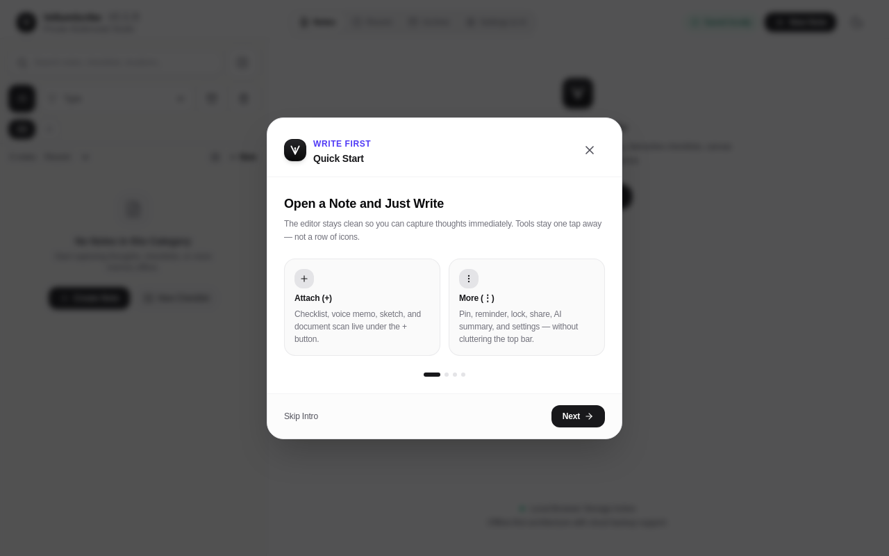
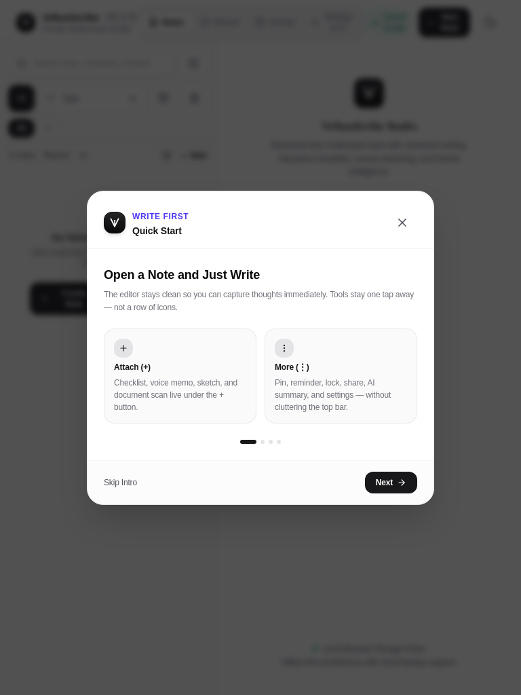
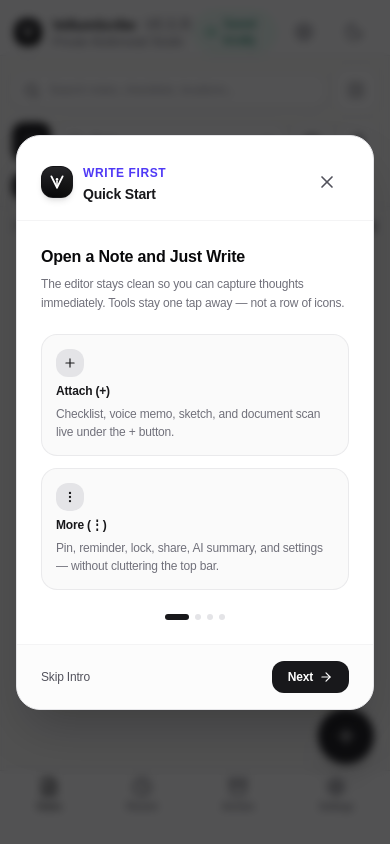
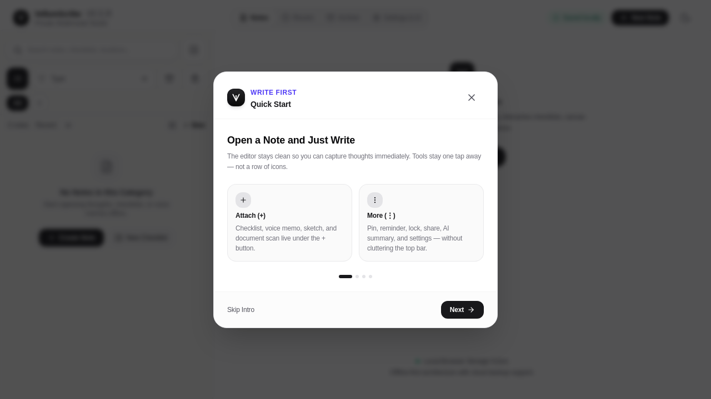

# OpenFounder

[](https://github.com/Perchemop/OpenFounder/actions/workflows/ci.yml)

**Evidence-driven AI co-founder workspace for startup validation.**

OpenFounder helps founders move from idea → validated problem → tested solution by treating every claim as an assumption until proven otherwise. It combines structured workflows (phases, evidence ledger, experiments, interviews, risk register) with a multi-provider AI co-founder that refuses to invent sources or customer quotes.

---

## Core Philosophy

- **Challenge unsupported claims**
- Clearly separate: **evidence** · **inference** · **assumption** · **hypothesis** · **recommendation**
- Prefer small, falsifiable experiments over large speculative plans
- Never invent market stats, customer quotes, or sources

---

## Features

### Workspace Modules
- **Dashboard** – Project health, risk snapshot (open / hot / mitigated), and highest-value next action
- **Phases** – Guided 10-phase founder journey with required tasks
- **Evidence Ledger** – Claims with status (unverified → experiment_confirmed), verbatim
  quotes, sources, and a promotion guardrail: a claim cannot be marked research-backed,
  customer-confirmed, or experiment-confirmed without the matching evidence.
- **Risk Register** – Impact × probability scoring, filters, mitigation & next tests
- **Research** – Structured source logging
- **Competitors** – Teardowns with strengths/weaknesses/complaints
- **Validation / Experiments** – Hypothesis → method → success/failure criteria
- **Customer Interviews** – Mom-Test style logging + verbatim quotes
- **Canvas** – Visual relationship mapping
- **MVP Planner** – MoSCoW prioritization
- **Roadmap** – Dependency-aware planning
- **Business Model** – Lean Canvas + unit economics
- **GTM** – Channel mapping & checklist
- **Landing Page Studio** – Smoke-test copy generation
- **Documents** – Exportable packages

### AI Co-Founder
Multiple providers with configurable models and graceful fallback:

| Provider | Notes |
|----------|--------|
| Server Gemini | Uses `GEMINI_API_KEY` (recommended for hosted) |
| Direct Gemini (BYOK) | Browser → Google; primary + ordered fallback models on 429/503 |
| OpenAI-compatible | OpenAI, Groq, Together, DeepSeek, LocalAI… |
| Anthropic Claude | Direct browser API |
| Ollama | Fully local / privacy-first |
| Offline Rules | 100% free, zero network, deterministic heuristics |

**Settings → AI Providers** lets you pick provider, model presets (or custom IDs), Gemini fallback list, temperature, and max tokens. Keys can stay session-only or persist in localStorage.

Keyboard shortcuts:
- `⌘/Ctrl + J` → Toggle AI Co-founder panel
- `⌘/Ctrl + K` → Command palette

---

## Screenshots & Walkthrough

Desktop workspace:



Tablet view:



Mobile view:



Empty state (no project):



### Walkthrough

1. **Create a project** — Open the app, click "Create New Project", and fill in your idea, problem, target market, and founder context. Or click "Load Demo Workspace (TradePulse)" to explore with example data.
2. **Work through phases** — The sidebar guides you through 10 founder phases. Complete tasks in each phase to advance.
3. **Log evidence** — In the Evidence Ledger, record claims with status (assumption → unverified → research-backed → customer-confirmed → experiment-confirmed). A claim cannot be promoted without matching evidence.
4. **Score risks** — In the Risk Register, score each risk by impact × probability. The dashboard highlights "hot" open risks (score ≥ 4) as your next priority.
5. **Run experiments** — Design falsifiable tests in Validation. Results feed back into evidence confidence.
6. **Record interviews** — Log customer discovery interviews with verbatim quotes in Customer Interviews.
7. **Plan MVP & Roadmap** — Scope features in MVP Planner (MoSCoW) and map milestones in Roadmap.
8. **Export documents** — Generate Markdown or JSON documents from the Documents page, or export your full workspace as JSON from Settings → Data.

---

## Tech Stack

- **Frontend**: React 19 + TypeScript + Vite 6 + Tailwind CSS 4
- **Local Database**: Dexie (IndexedDB) with Zod schema validation
- **State**: React Context (`ProjectContext` + `useProject` hook)
- **Server**: Express + optional Gemini (for `/api/ai/*` routes)
- **Testing**: Vitest (validation, risk scoring, model defaults, context builder, phases, IDs)
- **Deploy**: Static build → GitHub Pages (server routes fall back gracefully)

---

## Quick Start

```bash
git clone https://github.com/Perchemop/OpenFounder.git
cd OpenFounder

bun install          # canonical package manager (bun.lock is committed)

# Full stack (Express + Vite) – recommended
bun run dev

# Frontend only
bun run dev:vite

bun run lint         # tsc --noEmit
bun run test         # vitest run
bun run build:static # production static assets
```

CI (`.github/workflows/ci.yml`) runs the type check, the test suite on Ubuntu, macOS, and
Windows, and the static build on every pull request. Treat CI as the authority rather than a
local run.

### Environment

Copy `.env.example` → `.env`:

```env
GEMINI_API_KEY=your_key_here   # optional – enables server-side AI
```

Without a server key the app still works fully offline or with user-provided keys (Settings → AI Providers).

---

## How the App Works

### 1. Boot & local data
1. `main.tsx` mounts React inside an `ErrorBoundary`.
2. `ProjectProvider` loads settings from `localStorage`, opens Dexie (`OpenFounderDB`), and optionally activates an existing project (never auto-seeds synthetic data without consent).
3. Entity tables (evidence, risks, experiments, …) load for the active project ID.

### 2. Layout shell
`App.tsx` is a thin shell:
- **Navbar** – project switcher, theme, settings, AI toggle
- **Sidebar** – workspace tabs with badges (unverified evidence, active experiments, open risks)
- **Main** – active page component
- **AICofounderPanel** – slide-over chat
- Modals: New Project, Settings, Command Palette

### 3. Validation workflow (intended path)
1. **New Project** – capture problem, user, constraints, starting point → stored in IndexedDB.
2. **Phases** – work through 10 founder phases; complete tasks and advance phase index.
3. **Evidence** – log claims; status starts as assumption/unverified; promote only with real signals.
4. **Risks** – score impact × probability (1–9); track mitigation and next tests. Dashboard prioritizes “hot” open risks (score ≥ 4).
5. **Research / Competitors / Interviews** – structured inputs that feed the AI context string.
6. **Experiments** – falsifiable tests with success/failure criteria; results feed evidence.
7. **MVP / Roadmap / GTM / Business / Landing** – plan only after riskiest assumptions are under test.

### 4. AI co-founder
1. `buildProjectContext()` serializes workspace data (within token budget).
2. User message + context + strong system prompt go to the active `AIProvider`.
3. Providers: Server/Direct Gemini (with model candidate fallback), OpenAI-compatible, Anthropic, Ollama, or Offline Rules.
4. Offline mode returns deterministic guidance from local counts (no network).

### 5. Privacy & backup
- All project data lives in **browser IndexedDB**.
- Export/import full JSON packages from Settings → Data.
- API keys: session-only by default, or opt-in localStorage.

### 6. Hosting modes
| Mode | Command | AI |
|------|---------|-----|
| Full stack | `npm run dev` | Server Gemini if `GEMINI_API_KEY` set; else BYOK / offline |
| Static (GitHub Pages) | `npm run build:static` | Direct Gemini / OpenAI / Anthropic / Ollama / Offline only |

---

## Architecture Highlights

### State (`src/context/ProjectContext.tsx`)
Centralized project, entities, AI config, theme, modals. Derived: evidence counts, open risks, AI context string.

### Data (`src/db/`)
Dexie tables, Zod validation, export/import with optional ID remapping, settings persistence.

### AI (`src/ai/`)
- `providerTypes` – interface + system prompt
- `providersGemini` / `OpenAI` / `Anthropic` / `Ollama` / `Offline`
- `modelDefaults` – presets, `buildGeminiModelCandidates`, parse/format fallbacks
- `contextBuilder` – workspace → prompt text

### Risks (`src/utils/riskScoring.ts` + `RisksPage` + Dashboard snapshot)
Pure scoring helpers; full CRUD register; dashboard strip for open/hot risks.

---

## Tests

```bash
npm test
```

Coverage includes:
- Zod / export validation
- Workspace referential integrity (canvas edges, experiment → evidence, roadmap dependencies)
- Risk scoring (`riskScore`, hot/open, sort)
- Evidence integrity promotion rules (`evaluateEvidencePromotion`, integrity summary)
- Model defaults (`buildGeminiModelCandidates`, parse/format fallbacks)
- `buildProjectContext`
- `FOUNDER_PHASES` structure
- `generateId` uniqueness & format

---

## Project documentation

| Document | Purpose |
| --- | --- |
| [docs/project-brief.md](docs/project-brief.md) | Product identity, user, problem, success definition |
| [docs/scope.md](docs/scope.md) | In-scope and out-of-scope capabilities |
| [docs/inspiration.md](docs/inspiration.md) | Public frameworks and clean-room boundary |
| [docs/architecture.md](docs/architecture.md) | Stack, runtime shape, data model, domain rules |
| [docs/parity.md](docs/parity.md) | Capability matrix with honest status |
| [docs/assumptions-and-questions.md](docs/assumptions-and-questions.md) | Assumptions and open questions |
| [docs/development.md](docs/development.md) | Contribution flow and CI-only verification |
| [docs/qc/manual-qc.md](docs/qc/manual-qc.md) | Manual quality checklist |
| [IMPLEMENTATION_PLAN.md](IMPLEMENTATION_PLAN.md) | Vertical-slice plan |
| [REQUIREMENTS_TRACEABILITY.md](REQUIREMENTS_TRACEABILITY.md) | Requirement → code → test mapping |
| [DECISIONS.md](DECISIONS.md) | Decision log |
| [PROGRESS.md](PROGRESS.md) | Session log with verified results |
| [CHANGELOG.md](CHANGELOG.md) | Release notes |
| [ATTRIBUTION.md](ATTRIBUTION.md) | Third-party licences and asset provenance |
| [CONTRIBUTING.md](CONTRIBUTING.md) | How to contribute, and the licence terms for PRs |
| [ROADMAP.md](ROADMAP.md) | Readiness percentages and staged milestones |

---

## Roadmap

- [x] ProjectContext extraction
- [x] Error Boundary
- [x] Risk Register UI + Dashboard snapshot
- [x] Expanded unit tests
- [x] Configurable model lists, temperature, max tokens
- [x] Evidence integrity guardrails + claim editing
- [x] Pull-request CI on Ubuntu, macOS, and Windows
- [x] Documentation and tracking baseline
- [x] Dashboard evidence-integrity score
- [x] Full-text search across research, interviews, risks, roadmap
- [x] Accessibility audit (human pass recorded, automated axe scan in CI)
- [x] Installable PWA with an offline app shell
- [ ] Optional cloud sync (still local-first)

## Contributing

Contributions are welcome. Please see CONTRIBUTING.md for how to file bugs, propose features, set up a dev environment, and submit pull requests. The project aims to respond to non-security issues within 7 days and prioritises accessibility reports. Review is public; code-of-conduct and security issues are handled privately.

## License

Dual licensed under **MIT OR Apache-2.0**, at your option — see [LICENSE](LICENSE),
[LICENSE-MIT](LICENSE-MIT), [LICENSE-APACHE](LICENSE-APACHE), and
[ATTRIBUTION.md](ATTRIBUTION.md). Contributions are accepted under the same terms
([CONTRIBUTING.md](CONTRIBUTING.md)).

---

Built for founders who prefer evidence over optimism.
